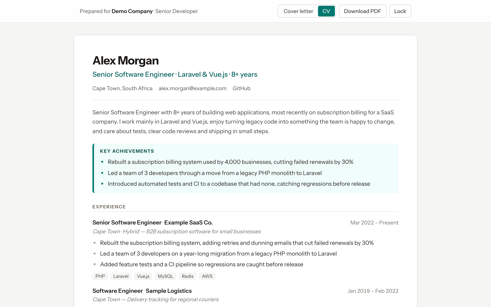
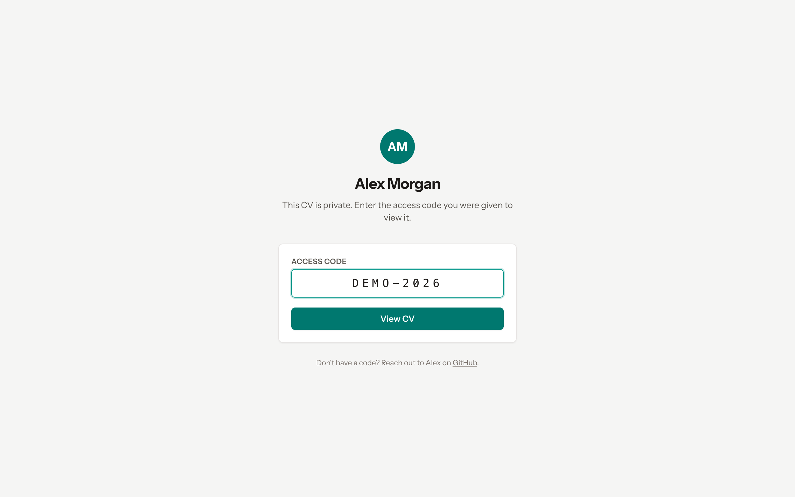
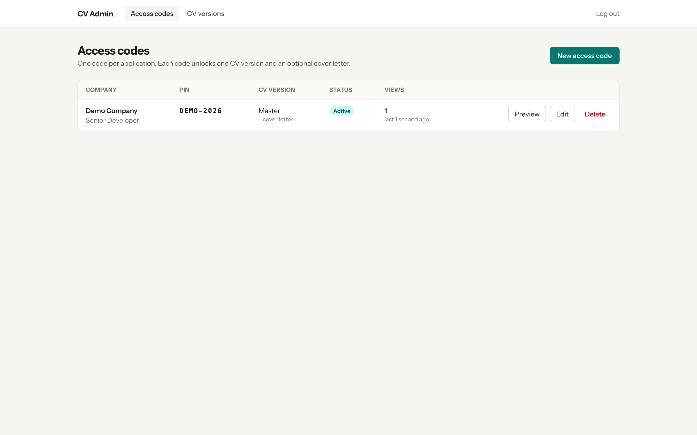
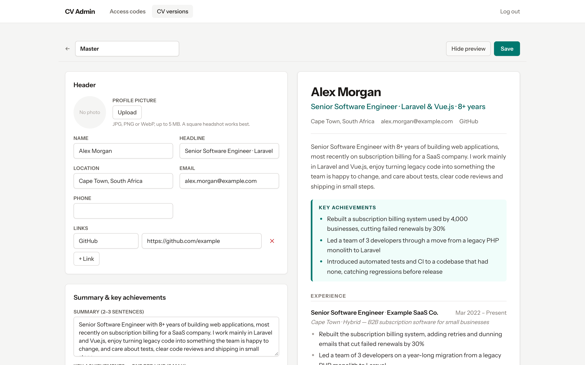

# CV Portal

A self-hosted, PIN-protected CV site. Every job application gets its own access code, which unlocks a
CV version and an optional cover letter tailored to that company, and you can see when and how often they opened it.



## Features

- **One access code per application.** Each code unlocks one CV version, with an optional cover letter you can switch off without losing the text.
- **Tailored CV versions.** Keep a complete "Master" CV, duplicate it, and trim or reorder it for a type of role.
- **View tracking.** See whether a company opened your CV, how often, and when.
- **Photo and references.** Add a profile picture and references per CV version.
- **Download as PDF.** Visitors can save a clean A4 PDF straight from their browser.
- **Expiry and revocation.** Codes can expire on a date, and disabling one ends any open session immediately.

| PIN entry | Access codes | CV editor with live preview |
|---|---|---|
|  |  |  |

## Stack

Laravel 13, Inertia v3, Vue 3, Tailwind CSS 4 and SQLite. Requires PHP 8.3+ and Node 20.19+.

## Getting started

```bash
composer install
npm install
cp .env.example .env && php artisan key:generate
touch database/database.sqlite
php artisan migrate --seed      # seeds a sample "Master" CV (+ demo PIN DEMO-2026 when APP_ENV=local)
php artisan cv:admin            # create your admin login
composer run dev
```

- Visitors: `/` → enter the PIN → `/cv`
- Admin: `/admin/login`

Replace the sample CV with your own in the admin (**CV versions → Master**), or edit
`database/data/master-cv.json` before seeding.

## Configuration

Set these in `.env`:

| Variable | Purpose |
|---|---|
| `CV_OWNER_NAME` | Your name, shown on the PIN page and in the browser tab title. |
| `CV_CONTACT_URL` | Optional link for visitors without a code, e.g. your LinkedIn profile. |
| `CV_CONTACT_LABEL` | The label for that link (default `LinkedIn`). |
| `TRUSTED_PROXIES` | Leave empty unless the app sits behind a load balancer or CDN. See `config/trustedproxy.php`. |

## Sending your CV

1. **CV versions:** make sure "Master" is complete, then duplicate it for each type of role and tailor the copy.
2. **Access codes → New:** enter the company, the role and the CV version, and paste the cover letter. A PIN is generated for you.
3. **Preview** shows exactly what the company will see, without counting a view.
4. Send them the site's URL and the PIN.

## Security

- PINs are stored encrypted, plus a keyed hash for lookup. **Changing `APP_KEY` breaks every existing code.**
- PIN entry is limited to 5 attempts per minute and 30 per day per IP; admin login to 5 per minute.
- Photos are stored privately and served through signed links that expire after 12 hours.
- Every page sends `noindex`, and `robots.txt` blocks crawlers.

## Deploying

Any server that runs PHP and keeps its disk between deploys works. With Laravel Forge and zero-downtime deployments:

- Add `storage` as a **shared path**, so uploaded photos survive deploys.
- Point `DB_DATABASE` at a file outside the release folders, e.g. `/home/forge/your-site/database.sqlite`.
- Run `npm ci && npm run build` in the deploy script, because built assets aren't committed.
- Back up the SQLite file and `storage/app/private/`.

## Tests

```bash
php artisan test
```

## License

MIT. See [LICENSE](LICENSE).
